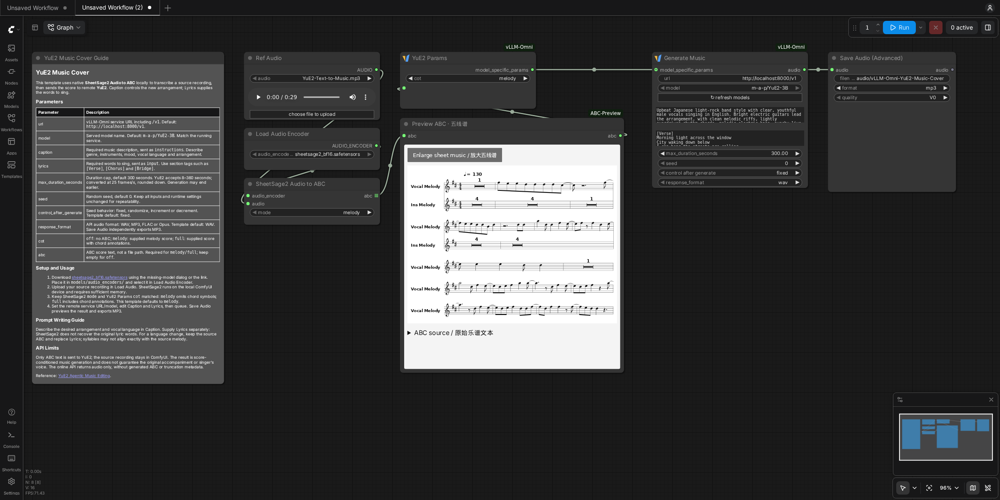
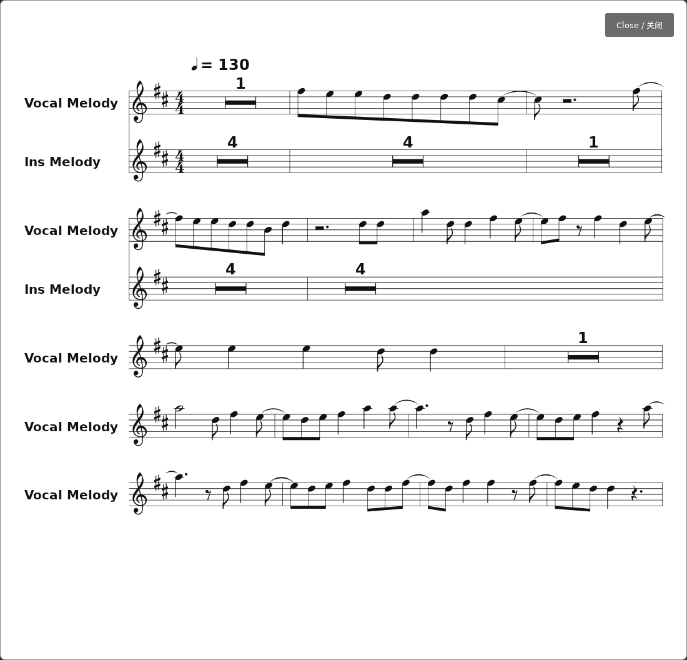

# ABC Sheet Music Preview for ComfyUI

Display ABC notation as sheet music inside ComfyUI, open an enlarged view,
and inspect the original ABC text. The preview passes the score unchanged to
downstream nodes, including YuE2 music generation.

## Installation

Link or copy this directory into `ComfyUI/custom_nodes`, then restart ComfyUI
and refresh the browser:

```bash
ln -s /path/to/vllm-omni/apps/ComfyUI-ABC-Preview /path/to/ComfyUI/custom_nodes/ComfyUI-ABC-Preview
```

No additional Python dependencies or model weights are needed for the preview.
The bundled ABCJS renderer runs in the browser without external network requests.

## Usage

Add **Preview ABC Sheet Music** from `audio/notation`. Connect the ABC output
from **SheetSage2 Audio to ABC**, **YuE2 Generate ABC**, or another string node.
Run the upstream nodes to update the score. Use **Enlarge sheet music** for a
larger view, or expand **ABC source** to inspect the text.

Saved workflows retain the last displayed score in node properties. This is a
preview of the previous execution; run again after changing the input.

The [YuE2 cover example](example_workflows/vLLM-Omni%20YuE2%20Cover%20with%20Sheet%20Music.json)
also requires [ComfyUI-vLLM-Omni](../ComfyUI-vLLM-Omni/README.md), a running YuE2
server, and the SheetSage2 weights described in its music-cover instructions.
Upload a reference recording in **Load Audio** and set the server URL before
running. The example contains no generated audio or cached score.

## Screenshots

YuE2 cover workflow with an inline score preview:



Enlarged score view:



The displayed score was transcribed by SheetSage2 from a 30-second YuE2-generated
music sample using the text-to-music template's caption and lyrics, `cot=off`,
seed `0`, and a 30-second duration cap. It is generated/transcribed material,
not a reference score or a transcription-accuracy measurement.

## Third-party code

ABCJS 6.7.0 is bundled unmodified under its MIT license. See
[the vendor notice](web/vendor/README.txt) and
[the license](web/vendor/abcjs-LICENSE.md).
